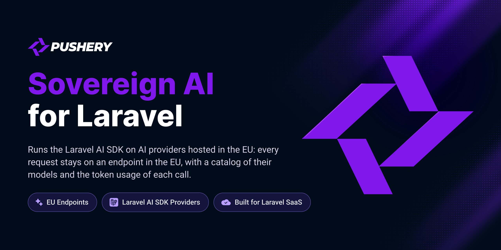

<p align="center">
  <a href="https://github.com/pushery/sovereign-ai-for-laravel">
    
  </a>
</p>

# Sovereign AI for Laravel

[](https://packagist.org/packages/pushery/sovereign-ai-for-laravel)
[](https://packagist.org/packages/pushery/sovereign-ai-for-laravel)
[](https://packagist.org/packages/pushery/sovereign-ai-for-laravel)
[](LICENSE)

[](https://pestphp.com)


[](https://phpstan.org)
[](https://laravel.com/docs/pint)

IONOS AI Model Hub and OVHcloud AI Endpoints as providers for the Laravel AI SDK, held to endpoints in the EU, with a model catalog and token usage.

## Documentation

**Full documentation at
[docs.pushery.com/sovereign-ai-for-laravel](https://docs.pushery.com/sovereign-ai-for-laravel/).**
This README is the quick start; the guides and the configuration reference live there.

## Requirements

- PHP 8.4+
- Laravel 13+
- `laravel/ai` 1.4+, installed with the package

The package keeps no table and needs no database.

Tested on the floor of the declared PHP range, because a `>=` promise is only proven
by running on the boundary, and on the minor version above it, so the range above the
floor is exercised here rather than first by a consumer.

## Installation

```bash
composer require pushery/sovereign-ai-for-laravel
```

The service provider is registered automatically through package discovery. Put the keys of
the clouds you use into `.env`:

```dotenv
SOVEREIGN_AI_IONOS_KEY=
SOVEREIGN_AI_OVHCLOUD_KEY=
```

## Configuration

Publish the configuration file:

```bash
php artisan vendor:publish --tag=sovereign-ai-config
```

This writes `config/sovereign-ai.php`, where every option is documented inline: which clouds
are registered, the endpoint and the default models of each, and models to add to the catalog.
The package ships no migrations, routes or views.

## Usage

The package registers two providers of the Laravel AI SDK, `ionos` (IONOS AI Model Hub) and
`ovhcloud` (OVHcloud AI Endpoints). Every agent can use them:

```php
use function Laravel\Ai\agent;

$response = agent('You answer in one sentence.')->prompt('What is the capital of France?', provider: 'ionos');

$response->text;
$response->usage->inputTokens;
```

Each request goes only to an endpoint the package lists for its cloud,
`https://openai.inference.de-txl.ionos.com/v1` and `https://oai.endpoints.kepler.ai.cloud.ovh.net/v1`;
any other URL stops the boot. A request with a JSON schema, tools or embeddings is refused before
it is sent when the catalog does not list that capability for its model, and an error from a cloud
names the provider and the cause. The
[documentation](https://docs.pushery.com/sovereign-ai-for-laravel/) covers the model catalog,
the errors, the token usage, the configuration, and what both clouds state about data processing
and training.

## Testing

The test suite is not part of the published package: the tests and their PHPUnit
configuration stay in the development repository, so a clone of this repository has no
`composer test`. [CONTRIBUTING.md](https://github.com/pushery/sovereign-ai-for-laravel/blob/main/CONTRIBUTING.md) says how a change is tested on its way in.

## Security

Please review the [security policy](SECURITY.md) and report vulnerabilities
privately rather than opening a public issue.

## Built by Pushery

This package is built and maintained by [Pushery](https://www.pushery.com) — a
Berlin-based studio building Laravel applications, SaaS products, and open-source
tools.

Building a Laravel UI? [WireKit](https://www.wirekit.app) is Pushery's open-source
Livewire component kit.
Browse the rest of our work at [pushery.com](https://www.pushery.com).

## License

The MIT License (MIT). See [LICENSE](LICENSE) for details.
